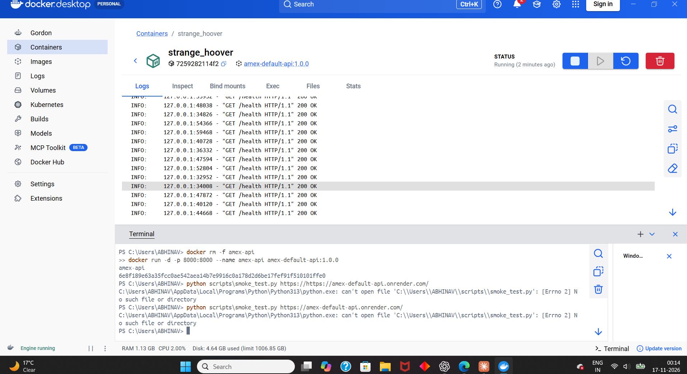
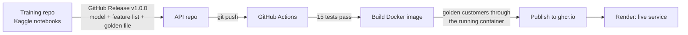
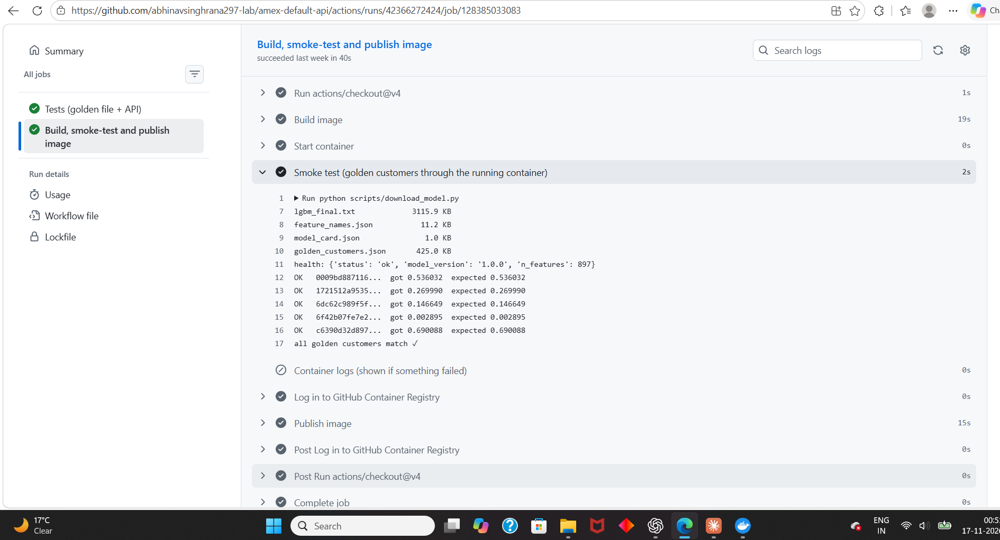

# AmEx Default Prediction API

[](https://github.com/abhinavsinghrana297-lab/amex-default-api/actions/workflows/ci.yml)

A FastAPI service that takes a credit-card customer's raw monthly statements and returns the probability that they will default. It serves a LightGBM model trained on the [American Express Default Prediction](https://www.kaggle.com/competitions/amex-default-prediction) data (16 GB, 458k customers, 5.5M statements).

- **Live demo:** https://amex-default-api.onrender.com/docs (free hosting: the first request after a quiet period takes about a minute to wake the server)
- **Training repo:** [amex-default-training](https://github.com/abhinavsinghrana297-lab/amex-default-training) (data pipeline, experiments, model selection)
- **Model:** LightGBM, 897 features. AMEX metric **0.798** on an untouched hold-out and **0.801** on the Kaggle private leaderboard.



## Run it

```bash
docker run -p 8000:8000 ghcr.io/abhinavsinghrana297-lab/amex-default-api:latest
```

Then open http://127.0.0.1:8000/docs.

## Use it

`POST /predict` takes the statements of **one** customer, in any order, in the same format as the original Kaggle CSV:

```json
{
  "statements": [
    {"customer_ID": "0009bd88…", "S_2": "2018-03-15", "P_2": 0.43, "D_63": "CR", "D_64": "O", "B_1": 0.02},
    {"customer_ID": "0009bd88…", "S_2": "2018-02-14", "P_2": 0.45, "D_63": "CR", "D_64": "O", "B_1": 0.03}
  ]
}
```

```json
{"customer_ID": "0009bd88…", "default_probability": 0.536032, "model_version": "1.0.0"}
```

- Any of the 188 statement columns may be left out. A missing column is treated as a missing value, which the model handles the same way it did in training.
- Invalid input is rejected with a `422` and a message naming the problem: an unknown category, a wrong date format, text where a number should be, an unknown column name (a typo), or statements from two customers in one request.
- `GET /health` reports the service status and the model version.

## How it works



One request goes through three steps:

| Step | File | What happens |
|---|---|---|
| Validate | `app/schemas.py` | Pydantic checks types, dates, categories and column names |
| Build features | `app/features.py` | Raw statements → 897 features, with the same code that built the training features |
| Predict | `app/predict.py` | LightGBM model (loaded once at startup) → probability |

## How I know it gives the same answers as training

The model was trained in a different repo, so the biggest risk is **training-serving skew**: the API computing a feature slightly differently from training. Nothing crashes when that happens; the predictions are just quietly wrong.

To guard against it, the model release includes a **golden file**: 5 real hold-out customers with their raw statements, the 897 features that training computed for them, and the probability the model gave. Three checks use it:

1. **Unit tests** rebuild the features from the raw statements and compare them with the training values (tolerance 1e-5).
2. **API tests** send the same customers through HTTP and compare the probabilities (tolerance 1e-6).
3. **A smoke test in CI** sends them to the built, running Docker container before the image is published.



I checked that these tests can fail. Removing the denoising step made the golden test report "137 values differ", and swapping two category codes made it report "1 value differs in D_63".

## Design decisions

| Decision | Reason |
|---|---|
| Separate training and serving repos | The service stays small, tested and stable while experiments change freely. The cost (feature code in two places) is covered by the golden-file tests. |
| Model shipped as a versioned GitHub Release | The API pins one version in `scripts/download_model.py`. Upgrading or rolling back is a one-line change. |
| Model baked into the Docker image | One image always means one known model. It runs without network access. |
| Feature names shipped with the model | The model only knows its columns by position. A swapped column would not crash; it would give wrong answers. |
| Raw input format, strict validation | Clients send data the way they store it. Mistakes are rejected with a clear message. |
| Same Polars code as training | Switching libraries changes edge cases. For example, the standard deviation of one value is missing in Polars but 0 in NumPy. |
| Images tagged with the commit id and `latest` | The commit tag never changes, so any earlier version can be run again for a rollback or an audit. |

## Develop

```bash
python -m venv .venv
.venv\Scripts\activate            # Windows  (Linux/macOS: source .venv/bin/activate)
pip install -r requirements-dev.txt
python scripts/download_model.py  # fetches release v1.0.0 into models/
python -m pytest -v               # 15 tests
uvicorn app.main:app --reload     # http://127.0.0.1:8000/docs
```

To test a running server, local or remote:

```bash
python scripts/smoke_test.py https://amex-default-api.onrender.com
```

```
app/        features.py  predict.py  schemas.py  main.py
tests/      test_golden.py  test_predict.py  test_api.py
scripts/    download_model.py  make_example_request.py  smoke_test.py
Dockerfile  .github/workflows/ci.yml  requirements.txt  requirements-dev.txt
```

## Not built yet

This is a portfolio project, not a production system. A real deployment would also need authentication, HTTPS managed by the organisation, request logging and monitoring (latency, error rates, the distribution of predictions), data-drift detection, rate limiting, and a decision layer on top of the probability.

## Tech

Python 3.13 · Polars · LightGBM · FastAPI · Pydantic · Docker · GitHub Actions · GitHub Container Registry · Render
